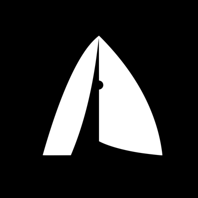
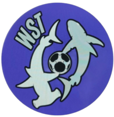
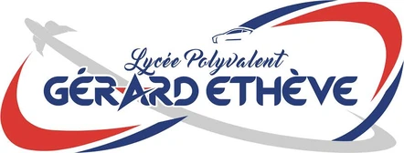
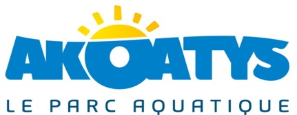

<!-- Bannière -->
<p align="center">
  
</p>

<p align="center">
  <a href="https://aurelien-loyer.dev">
    
  </a>
</p>

<p align="center">
  <a href="https://aurelien-loyer.dev"></a>
  <a href="https://www.linkedin.com/in/aurelien-loyer-epi/"></a>
  <a href="mailto:aurelienloyer.pro@gmail.com"></a>
  <a href="https://github.com/aurelien-loyer-dev"></a>
</p>

<p align="center">
  
  
  
</p>

---

## 👋 À propos

Je suis **Aurélien**, étudiant en 3e année à **EPITECH La Réunion** (cursus Expert en Technologies de l'Information, Bac +5).
J'aime construire des produits complets : du serveur C++ temps réel au site React en PWA, en passant par des agents IA qui tournent en local.

- 🤖 **En ce moment** : stage à temps partiel chez **Free** (2 jours par semaine), où je développe un **agent IA interne** (pipeline RAG 100 % local, LangGraph, Mistral, SGLang).
- 🏗️ **Projet perso** : **BDE Hub**, un écosystème de 3 PWA React synchronisées en temps réel via Supabase, avec paiement SumUp.
- 🏆 **Hackathons** : 1re place au Hackathon FREE, 2e place au Hackathon Justice Tech, 2e du campus sur Zappy.
- 🎯 **Je cherche** : un **stage de 4 mois à partir d'avril 2027**, puis une année à l'international en 2027-2028.

<p align="center">
  <a href="https://www.epitech.eu">
    <picture>
      <source media="(prefers-color-scheme: dark)" srcset="assets/epitech-logo.svg" />
      
    </picture>
  </a>
  &nbsp;&nbsp;&nbsp;&nbsp;
  <a href="https://www.free.fr"></a>
  &nbsp;&nbsp;&nbsp;&nbsp;
  <a href="https://www.zeop.re"></a>
</p>

```js
const aurelien = {
  ecole: "EPITECH La Réunion · 3e année",
  poste: "Stagiaire (temps partiel) · Agent IA @ Free",
  focus: ["Full-stack web", "IA & RAG", "Systèmes (C / C++)"],
  langues: ["Français", "English"],
  recherche: "Stage 4 mois · avril → juillet 2027",
  contact: "aurelienloyer.pro@gmail.com",
};
```

---

## 🛠️ Stack

**Langages**

<p>
  
</p>

**Web & Backend**

<p>
  
</p>

**IA & Automatisation**

<p>
  
  
  
  
  
  
  
  
</p>

**DevOps & Environnement**

<p>
  
</p>

---

## 🚀 Projets à la une

| | Projet | Description | Stack | Liens |
|:---:|---|---|---|---|
|  | 🤖 **Agent IA interne** · *Free* | Pipeline RAG entièrement local : documentation interne hétérogène (PDF, Word) transformée en base de connaissances interrogeable par un agent. | Python · LangGraph · SGLang · Mistral · Ollama | 🔒 Privé |
|  | 🏗️ **BDE Hub** · *en cours* | 3 applications React installables (PWA) sur une base Supabase commune, synchronisées en temps réel : vitrine, boutique, admin. | React · Supabase · Cloudinary · SumUp API | [Démo](https://bdepitech-link.vercel.app/) |
|  | 🥇 **Couverture d'antenne** · *Hackathon FREE* | App géospatiale full-stack : 2 651 antennes à La Réunion et Mayotte, couverture 2D/3D, estimation de la puissance du signal. | TypeScript · Python · MapLibre · Leaflet · Docker | [Vidéo](https://youtu.be/6jD4o2KlAXg) |
|  | 🥈 **IRIS** · *Hackathon Justice Tech* | Site réalisé en 48 h pour régler les conflits à l'amiable, avec IRIS, une assistante IA locale (RAG) respectueuse du RGPD. | Next.js · Ollama · Docker | — |
| <picture><source media="(prefers-color-scheme: dark)" srcset="assets/epitech-logo.svg" /></picture> | 🎮 **Zappy** · *2e du campus* | Projet à 5 : serveur C++ temps réel, client graphique Raylib (rendu isométrique + 3D torique) et IA Python autonome. | C++ · Raylib · Python · TCP/poll | — |
| <picture><source media="(prefers-color-scheme: dark)" srcset="assets/epitech-logo.svg" /></picture> | 🤖 **Buddy** | App Android qui transforme le robot Buddy en guide conversationnel du Hub EPITECH. Présenté le 14 juillet à la Préfecture de La Réunion. | Kotlin · Android · Groq (LLM) · STT/TTS | [Repo](https://github.com/aurelien-loyer-dev/BUDDY-THE-ROBOT) |
| <picture><source media="(prefers-color-scheme: dark)" srcset="assets/epitech-logo.svg" /></picture> | 🖨️ **3D Planner** | Planning et réservation des imprimantes 3D d'EPITECH, connecté à l'API BambuLab. | React · TypeScript · Supabase Realtime | [Démo](https://3d-printer-epitech.vercel.app/?kiosk=1) |
|  | ♟️ **Échecs avec IA** | Jeu d'échecs jouable en ligne contre une IA Python. | React · Flask | [Démo](https://chess-game-vwsf.vercel.app/) · [Repo](https://github.com/aurelien-loyer-dev/ChessGame) |
|  | 📖 **Zistoire** · *Hackathon MACE* | Les clients d'un hôtel scannent un QR code et découvrent l'histoire de La Réunion en récit illustré. | Python · Flask · React | [Repo](https://github.com/aurelien-loyer-dev/zistoire-hackaton-mace) |
|   | 🏐 **WS Tchoukball** / **Tchouk'Leu** | Sites officiels de deux clubs de tchoukball réunionnais. | React · Supabase · Cloudinary | [wstchoukball.com](https://wstchoukball.com) · [tchoukleu.re](https://tchoukleu.re) |
| <picture><source media="(prefers-color-scheme: dark)" srcset="assets/epitech-logo.svg" /></picture> | 🐚 **42sh** | Shell Unix en C : pipes, redirections, gestion complète des processus. | C · NCurses | [Repo](https://github.com/aurelien-loyer/42sh) |
| <picture><source media="(prefers-color-scheme: dark)" srcset="assets/epitech-logo.svg" /></picture> | ⚔️ **Corewar** / 📡 **MyRadar** | VM où des programmes assembleur s'affrontent · simulation radar avec quadtree. | C · ASM · CSFML | — |

<p align="center">
  <a href="https://aurelien-loyer.dev"><b>➜ Tous les projets, avec photos et détails, sur mon portfolio</b></a>
</p>

---

## 🏆 Hackathons & distinctions

<p align="center">
  
  
  
  
</p>

---

## 🧭 Parcours

| | Période | Étape |
|:---:|---|---|
|  | oct. 2026 → fév. 2027 | 🤖 **Stage à temps partiel · Agent IA** @ Free · Python, LangGraph, Mistral, RAG |
| <picture><source media="(prefers-color-scheme: dark)" srcset="assets/epitech-logo.svg" /></picture> | 2026 → 2027 | 🏫 **EPITECH 3e année** · puis stage de 4 mois (avril → juillet 2027), **je cherche !** |
| <picture><source media="(prefers-color-scheme: dark)" srcset="assets/epitech-logo.svg" /></picture> | mars → août 2026 | 🏫 **EPITECH 2e année** · C++, POO, AWS |
|  | sept. 2025 → fév. 2026 | 💼 **Stage développeur web** @ ZEOP · migration PHP 3 → Laravel / PHP 8 |
| <picture><source media="(prefers-color-scheme: dark)" srcset="assets/epitech-logo.svg" /></picture> | 2024 → 2025 | 🏫 **EPITECH 1re année** · C, Unix |
|  | juillet 2024 | 🎓 **Bac général avec mention** · NSI & Maths |
|  | déc. 2023 → janv. 2024 | 🏄 **Sauveteur & moniteur de surf** @ Akoatys |

**La suite :** 4e année à l'international (2027-2028), puis diplôme Expert en Technologies de l'Information, Bac +5 (2029).

---

## 📊 Statistiques GitHub

<p align="center">
  
  
</p>

<p align="center">
  
</p>

<p align="center">
  
</p>

<p align="center">
  
  
  
</p>

### 📈 Activité

<p align="center">
  
</p>

### 🏅 Trophées

<p align="center">
  
</p>

### 🐍 Contributions

<p align="center">
  <picture>
    <source media="(prefers-color-scheme: dark)" srcset="https://raw.githubusercontent.com/aurelien-loyer/aurelien-loyer/output/github-contribution-grid-snake-dark.svg" />
    
  </picture>
</p>

---

## 🤝 Me contacter

Un stage, un hackathon, un projet IA ou web ? Écris-moi, je réponds vite.

<p align="center">
  <a href="https://aurelien-loyer.dev"></a>
  <a href="https://aurelien-loyer.dev/en"></a>
  <a href="https://www.linkedin.com/in/aurelien-loyer-epi/"></a>
  <a href="mailto:aurelienloyer.pro@gmail.com"></a>
  <a href="mailto:aurelien.loyer@epitech.eu"></a>
</p>

<p align="center">
  
</p>
